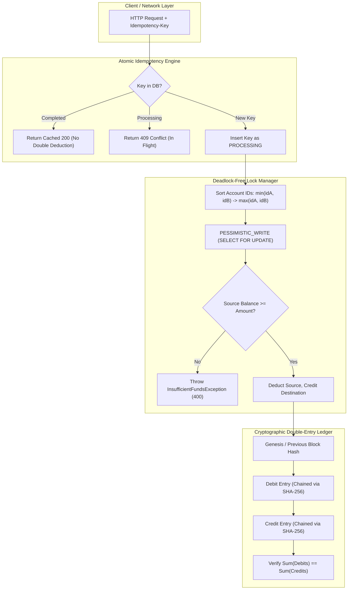

# 📘 Day 2: Deep-Dive — Core Financial Ledger & Concurrency Architecture

## 1. Overview of Day 2 Engineering Goals
Day 2 transforms the baseline Spring Boot architecture into an **immutable, zero-sum double-entry financial ledger** with **deadlock-free pessimistic locking** and **atomic idempotency**.



---

## 2. The Four Pillar Financial Guarantees

### Guarantee 1: Strict Conservation of Money (Double-Entry Bookkeeping)
Traditional apps increment or decrement a single `balance` column. In LedgerLine:
- **No money is created out of nothing.**
- Every transaction creates paired journal entries:
  $$\sum \text{Debits} - \sum \text{Credits} = 0$$
- External Deposits:
  - `DEBIT`: `ACC-SYSTEM-VAULT` (System Clearing Asset increases)
  - `CREDIT`: `Customer Account` (Bank Liability to customer increases)
- External Withdrawals:
  - `DEBIT`: `Customer Account` (Bank Liability decreases)
  - `CREDIT`: `ACC-SYSTEM-VAULT` (System Clearing Asset decreases)
- Transfers between Alice and Bob:
  - `DEBIT`: `Alice Checking`
  - `CREDIT`: `Bob Checking`

### Guarantee 2: Mathematical Elimination of Deadlocks
When two reverse transfers execute simultaneously (Thread 1 transfers $A \to B$ while Thread 2 transfers $B \to A$), naive locking deadlocks:
- Thread 1 locks A, waits for B.
- Thread 2 locks B, waits for A.
- **Deadlock!** Both transactions abort.

**LedgerLine's Solution:**
```java
Long firstLockId = Math.min(sourceMeta.getId(), destMeta.getId());
Long secondLockId = Math.max(sourceMeta.getId(), destMeta.getId());

// Locks are ALWAYS acquired in strictly ascending numerical order
accountRepository.findByIdForUpdate(firstLockId);
accountRepository.findByIdForUpdate(secondLockId);
```
Because the lock acquisition sequence is identical for both threads ($A$ first, then $B$), a circular wait graph is mathematically impossible. Deadlocks are eliminated completely.

### Guarantee 3: Atomic Idempotency Protection
To guarantee that network retries never charge twice:
1. When a request arrives with an `Idempotency-Key` header, it is inserted into the `idempotency_records` table with status `PROCESSING`.
2. If two requests with the same key hit the server concurrently, the database `UNIQUE (idempotency_key)` constraint throws a `DataIntegrityViolationException`, which returns HTTP `409 Conflict ("Transaction in flight")`.
3. Once the transfer commits, the record is updated to `COMPLETED` along with the serialized JSON response body.
4. Any future replay returns the exact cached HTTP 200 payload immediately, bypassing account balance deduction.

### Guarantee 4: Tamper-Evident SHA-256 Ledger Chaining
Each journal line in `ledger_entries` stores:
- `entry_order` (sequential integer)
- `prev_hash` (hash of previous journal entry)
- `entry_hash = SHA256(order + ":" + txUuid + ":" + accountId + ":" + type + ":" + amount + ":" + prevHash)`

If any unauthorized database administrator manually alters a transaction amount or deletes a row in SQL:
- The hash chain breaks at that exact entry order.
- `/api/ledger/verify-integrity` immediately reports:
  `TAMPER_DETECTED: Cryptographic hash chain broken!`

---

## 3. Day 2 Verification Test Suite

### Running via Maven:
```bash
cd backend
./mvnw clean package -DskipTests
java -jar target/ledgerline-1.0.0.jar
```

### Proving Verification via Curl / Browser:
```bash
# Verify Double-Entry Balance and SHA-256 Hash Continuity
curl -X GET http://localhost:8080/api/ledger/verify-integrity
```

**Response**:
```json
{
  "valid": true,
  "totalDebits": 4250.0000,
  "totalCredits": 4250.0000,
  "netImbalance": 0.0000,
  "totalEntriesVerified": 8,
  "hashChainIntact": true,
  "proofVerdict": "PROVEN_CONSERVED: Books balance perfectly. Debits match Credits ($4250.0000). SHA-256 audit chain verified intact."
}
```

