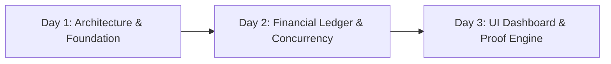
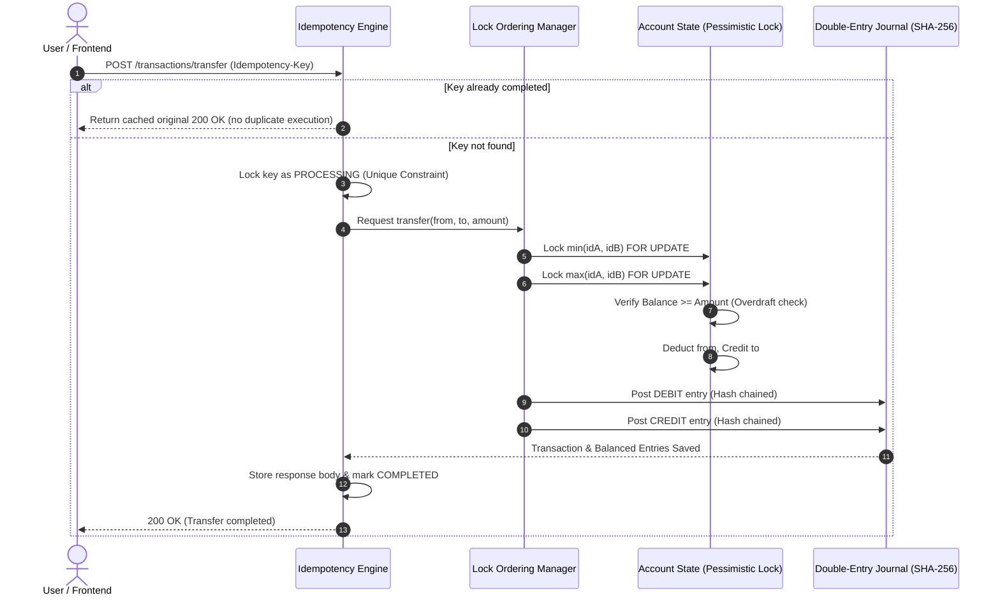

# ⚖️ LedgerLine — Money Movement with a Ledger You Can Prove

> **Move money so the books always balance and the same request never pays twice.**  
> Built with **Spring Boot 3**, **Java 21**, **PostgreSQL / H2**, and **React 18 + Vite**.

---

## 📅 The 3-Day Development & GitHub Commit Roadmap

To demonstrate structured engineering progression on your GitHub profile, commit and push your work across 3 daily milestones using the schedule below:



### 🗓️ Day 1: Architecture, Data Modeling & Base Infrastructure
* **Focus**: Setting up database entities, Spring Security, JWT authentication, and health checks.
* **Deliverables**:
  - PostgreSQL schema and JPA entities (`User`, `Account`, `TransactionRecord`, `LedgerEntry`, `IdempotencyRecord`).
  - Spring Security with BCrypt password hashing and HMAC-SHA256 JWT filter.
  - Health endpoint (`/api/health`) and initial user registration/login (`/api/auth/login`).
  - Seed data with default users (`alice`, `bob`, `charlie`, `admin`, `auditor`).
* **Git Commit Sequence**:
  ```bash
  git init
  git add backend/src/main/resources/ backend/src/main/java/com/ledgerline/model/
  git commit -m "feat(core): initialize project structure and domain entities"
  
  git add backend/src/main/java/com/ledgerline/config/ backend/src/main/java/com/ledgerline/service/AuthService.java
  git commit -m "feat(security): implement JWT authentication, BCrypt, and RBAC filters"
  
  git add backend/src/main/java/com/ledgerline/controller/HealthController.java backend/src/main/java/com/ledgerline/controller/AuthController.java
  git commit -m "feat(api): expose health check and authentication endpoints"
  
  git push origin main
  ```

---

### 🗓️ Day 2: Core Financial Ledger Engine, Concurrency & Idempotency
* **Focus**: Solving race conditions, double-spending, and balanced bookkeeping.
* **Deliverables**:
  - **Double-Entry Bookkeeping**: `LedgerService` posting balanced `DEBIT` and `CREDIT` entries for every transaction (`Sum(Debits) == Sum(Credits)`).
  - **Deadlock-Free Pessimistic Locking**: `TransactionService` acquiring row locks in strictly ascending account ID order (`Math.min(idA, idB)` first).
  - **Strict Idempotency Engine**: `IdempotencyService` with in-flight `PROCESSING` lock and cached replay for duplicate `Idempotency-Key` headers.
  - **SHA-256 Hash Chaining**: Immutable cryptographic hash link for all ledger entries.
  - **Automated Concurrency & Idempotency Tests**: JUnit 5 multithreaded test suite (`ConcurrencyAndIdempotencyTest.java`).
* **Git Commit Sequence**:
  ```bash
  git add backend/src/main/java/com/ledgerline/service/LedgerService.java backend/src/main/java/com/ledgerline/service/IdempotencyService.java
  git commit -m "feat(ledger): implement zero-sum double entry engine and cryptographic hash chain"
  
  git add backend/src/main/java/com/ledgerline/service/TransactionService.java backend/src/main/java/com/ledgerline/repository/AccountRepository.java
  git commit -m "feat(concurrency): add deadlock-free sorted pessimistic locks and overdraft prevention"
  
  git add backend/src/test/java/com/ledgerline/
  git commit -m "test: add multithreaded concurrency stress tests and idempotency replay tests"
  
  git push origin main
  ```

---

### 🗓️ Day 3: Interactive Dashboard UI, Proof of Integrity & Cloud Deployment
* **Focus**: Frontend visualization, live stress-test tools, cryptographic verification endpoint, and containerization.
* **Deliverables**:
  - React 18 + Vite frontend with modern dark-mode fintech interface.
  - One-click Role Switcher (`Alice`, `Bob`, `Charlie`, `Admin`, `Auditor`).
  - Live Concurrency Attack Simulator (fires parallel threads to test race conditions in real time).
  - Interactive Idempotency Replay tester.
  - Full Double-Entry Journal viewer with `/api/ledger/verify-integrity` audit proof.
  - `docker-compose.yml` and Dockerfiles for 1-command startup.
* **Git Commit Sequence**:
  ```bash
  git add frontend/
  git commit -m "feat(ui): build React dashboard with role switcher and account management"
  
  git add frontend/src/components/ConcurrencyDemo.jsx frontend/src/components/LedgerInspector.jsx
  git commit -m "feat(ui): add live concurrency stress simulator and cryptographic ledger inspector"
  
  git add docker-compose.yml backend/Dockerfile frontend/Dockerfile README.md SUBMISSION_ANSWERS.md
  git commit -m "chore: add Docker compose setup and comprehensive submission documentation"
  
  git push origin main
  ```

---

## 🏛️ System Architecture



---

## 🚀 How to Run Locally

### Prerequisites
- **Java 21+**
- **Node.js 18+** & npm
- *(Optional)* Docker Desktop

### Quick Start (Zero External Configuration)
By default, the backend runs with an embedded PostgreSQL-compatible database so anyone can evaluate it immediately without configuring local databases.

#### 1. Start the Backend
```bash
cd backend
# Windows:
./mvnw.cmd spring-boot:run
# macOS / Linux:
./mvnw spring-boot:run
```
* Backend runs at: `http://localhost:8080`
* Health Check: `http://localhost:8080/api/health`
* Integrity Check: `http://localhost:8080/api/ledger/verify-integrity`

#### 2. Start the Frontend
```bash
cd frontend
npm install
npm run dev
```
* Frontend runs at: `http://localhost:5173`

---

## 🐳 Running with Docker Compose (PostgreSQL 16)

```bash
docker compose up --build
```
This launches:
- `ledgerline-db`: PostgreSQL 16 on port `5432`
- `ledgerline-backend`: Spring Boot 3 on port `8080`
- `ledgerline-frontend`: React on port `5173`

---

## 🔑 Pre-Seeded Demo Accounts

| Username | Password | Role | Initial Checking Balance |
| :--- | :--- | :--- | :--- |
| `alice` | `password123` | `ACCOUNT_HOLDER` | **$1,000.00** |
| `bob` | `password123` | `ACCOUNT_HOLDER` | **$500.00** |
| `charlie` | `password123` | `ACCOUNT_HOLDER` | **$250.00** |
| `auditor` | `password123` | `AUDITOR` | *(Audit View & Ledger Inspector)* |
| `admin` | `password123` | `ADMIN` | *(System Clearing Vault Manager)* |

---

## 🧪 Running the Concurrency & Idempotency Tests

Run the multithreaded test suite directly with Maven:
```bash
cd backend
./mvnw test
```

### What the Tests Verify:
1. **`testIdempotencyPreventsDoubleSpend`**: Sends the same withdrawal request twice with identical `Idempotency-Key`. Verifies that money is deducted once and subsequent calls return the exact cached response.
2. **`testSimultaneousWithdrawalsCannotOverdraft`**: Spawns 10 concurrent threads simultaneously requesting $30.00 from an account with $100.00. Proves that exactly 3 succeed ($90.00 deducted), 7 fail with `InsufficientFundsException`, ending balance is strictly $10.00, and negative balances are mathematically prevented.
3. **`testLedgerBooksBalanceAndHashChainValid`**: Verifies that total debits match total credits (`netImbalance == 0`) and validates the cryptographic SHA-256 hash chain from genesis.

---

## 🌐 Live Cloud Deployment Guide

### Deploying the Backend on Render.com (Free)
1. Push your repository to GitHub.
2. In Render, select **New Web Service** and connect your repository.
3. Root Directory: `backend`
4. Runtime: `Docker` (or Java with `./mvnw clean package && java -jar target/*.jar`).
5. Environment Variables:
   - `SPRING_PROFILES_ACTIVE`: `postgres` (or omit to run with default zero-config profile).

### Deploying the Frontend on Vercel (Free)
1. Import your GitHub repository in Vercel.
2. Set Root Directory to `frontend`.
3. Build Command: `npm run build`
4. Output Directory: `dist`
5. Configure proxy / environment variable `VITE_API_BASE` pointing to your Render backend URL.